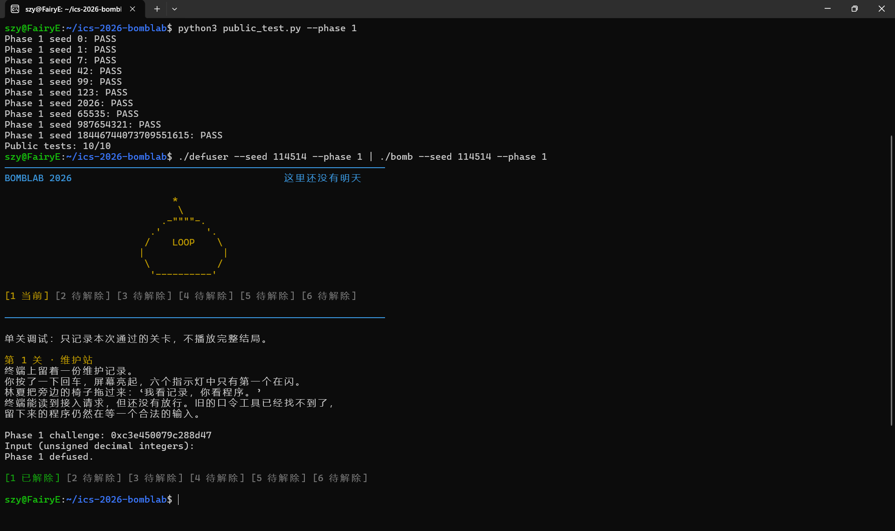
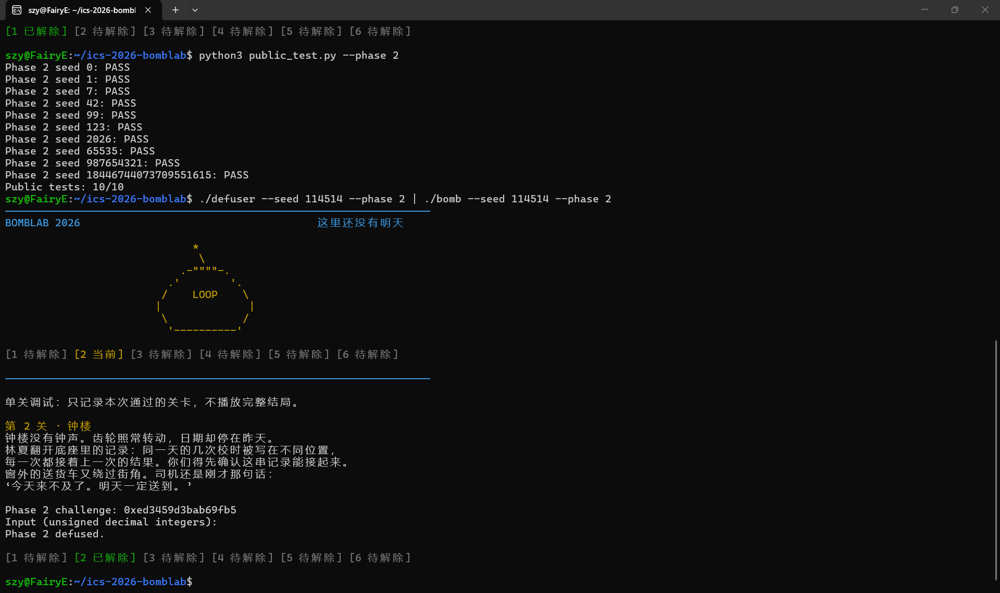
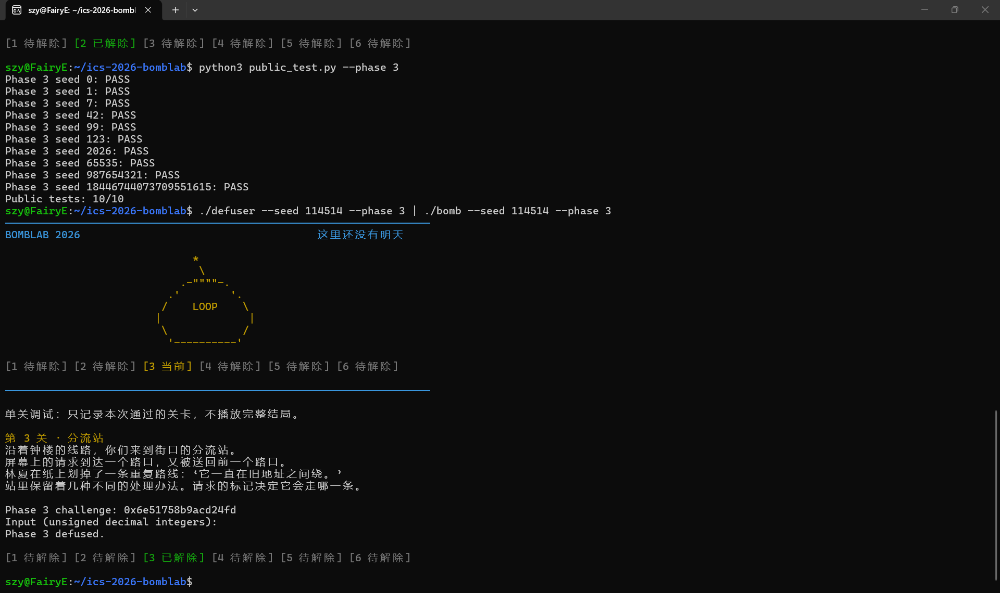
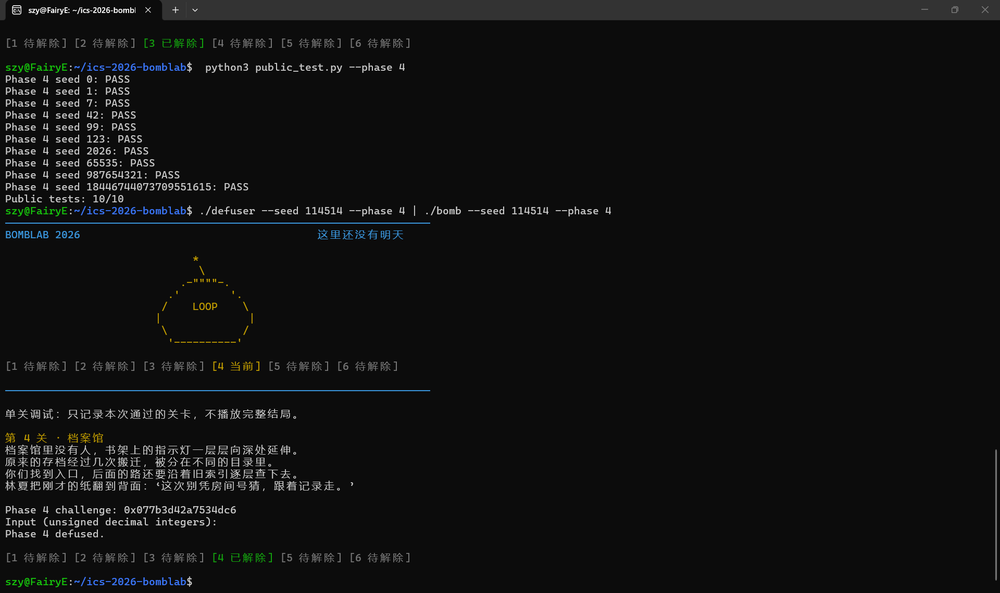
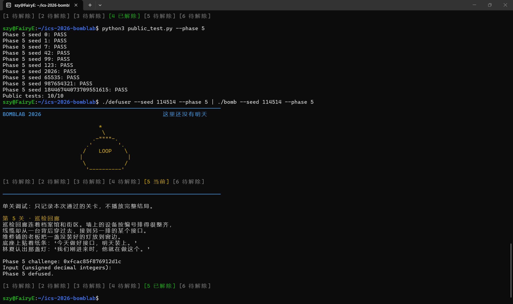
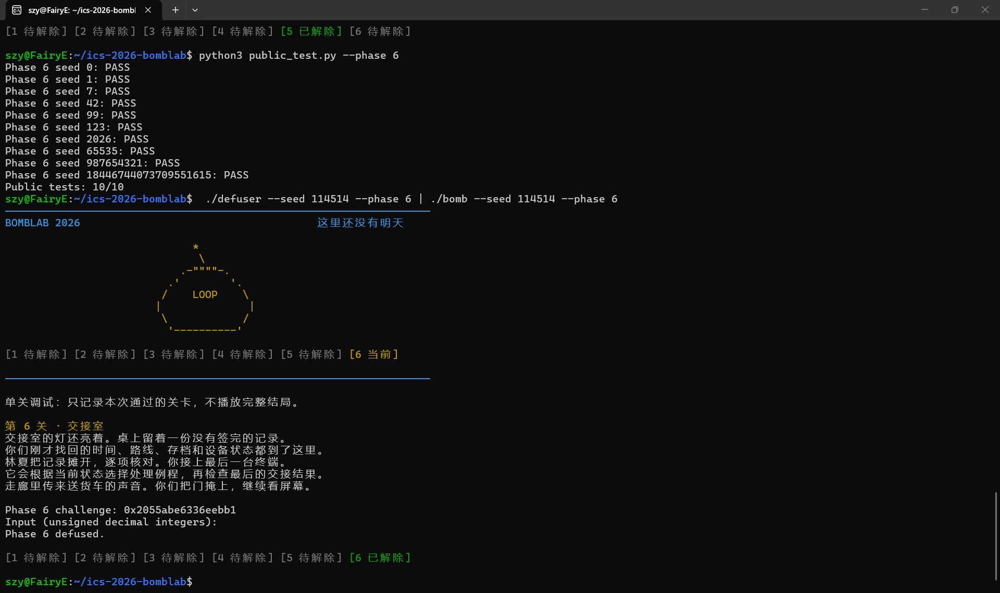
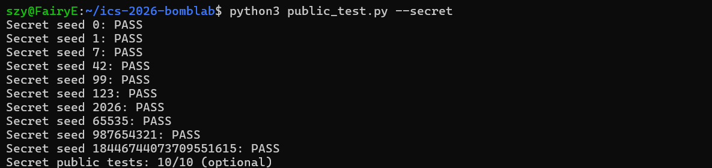
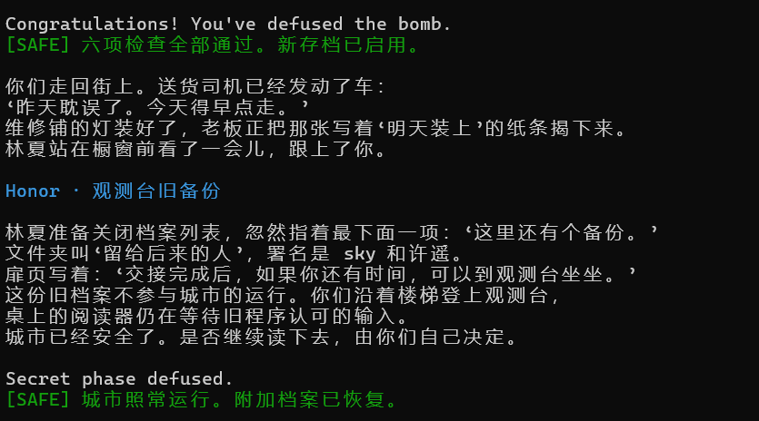
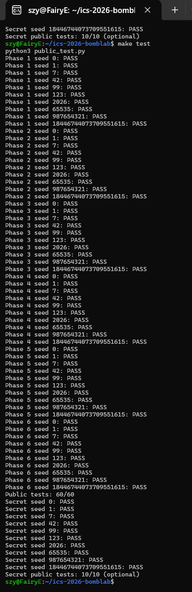
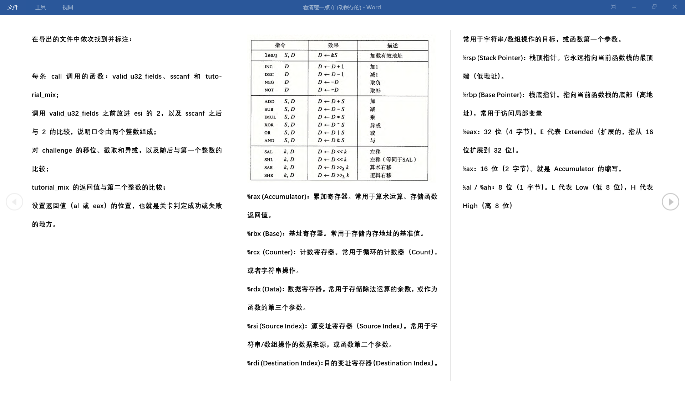

# Lab2 Report

首先先学了一点tutor的内容吧，感觉还不错

## Phase01



从我现在做完的角度来看的话其实Phase01其实就一个主函数p1_compute,里面包含了p1_step0,1,2（虽然我也不知道为什么顺序是1 0 2）可能是我的种子的缘故吧不过这个命名什么的倒也无所谓。里面的运算就是一些比较基础的运算吧然后就没了。然后解题如下：

在p1_compute之前先计算了：left=challenge>>32，right=challenge&0xFFFFFFFF，mid=(challenge >> 16) 

进入p1_compute，调用三个子函数：  p1_step1,0,2

```c
p1_step1:   p = (left + 0x6960) ^ right
p1_step0:   q = ((left * 3) + mid) ^ 0x88c3;
p1_step2:   ans = (p * 4) + (q ^ 0xa42f)
```
p1_step1（left, mid），算出p

p1_step0 （right, left），算出中间值q

p1_step2 （p, q），算出ans


## Phase02


从汇编代码+100处才开始主函数，根据cmp    $0x6,%eax 知道count = 6。

```c
0x00000000004020ea <+106>: mov %r13,%rax
0x00000000004020ed <+109>: mov -0x40(%rbp),%esi
0x00000000004020f0 <+112>: shr $0x20,%rax
0x00000000004020f4 <+116>: add %eax,%eax
0x00000000004020f6 <+118>: and $0x1fe,%eax
0x00000000004020fb <+123>: add $0x15,%eax
0x00000000004020fe <+126>: cmp %eax,%esi
```

这里通过和Phase01的计算类似的方法是得到了一个初值value0的。并且这个值会参与到后续的得到5个值的计算中

然后再看到

```c
0x000000000040210c <+140>: mov %r13,%rax
0x000000000040212f <+175>: jne 0x40210c <phase_02+140>
```

这两行大概知道这应该是一个for循环函数，然后循环中得到的结果被输出与答案比较

rdx是一个循环变量，他的值在1-5之间

```c
0x402102 <+130>: mov 0x18,%ecx # 初始移位量 shf = 24
0x402107 <+135>: mov 0x1,%edx # 循环索引 i = 1
...
0x40210c <+140>: mov %r13,%rax 载入 challenge
0x40210f <+143>: lea (%rsi,%rsi,2),%esi 前一个数字*3 (即 p*3)
0x402112 <+146>: shr %cl,%rax challenge右移shf位
0x402115 <+149>: and $0xf,%eax 截取低4位
0x402118 <+152>: add %edx,%eax 加上循环次数i
0x40211a <+154>: xor %esi,%eax与(p*3)异或
0x40211c <+156>: mov -0x40(%rbp,%rdx,4),%esi 取第i个数字然后保存
0x402120 <+160>: cmp %eax,%esi 验证答案
```

整体上Phase02就是先用challenge算一个初值，这个初值参与到后面的for循环里面，每次输出的值都会和答案比较。

## Phase03


前面都是一些简单的计算，但是到了p3_dispatch初见端倪，解开以后看到8个函数，再把它们全部算出来：

```c
ans2 = p * 5 + 0x4785b; break;
ans2 = (p * 2) ^ 0xf833;  break;
ans2 = p * 5+ 0x3c26; break;
 ans2 = (p ^ 0x21de) + (p >> 2); break;
ans2 = (p * 4) ^ 0x7b23; break;
ans2 = p * 5 + 0x289c4; break;
ans2 = p * 3 + 0x1b1c; break;
ans2 =(p ^ 0x2474) + (p >> 2); break;
```

具体计算我就给一个吧因为这个case里的计算比前两题都更简单一点：

```c
0x0000000000402190 <+0>: endbr64
0x0000000000402194 <+4>: lea 0x0(,%rdi,4),%eax   
                        # %eax=4*(之前算出来的数字)
0x000000000040219b <+11>: xor $0x7b23,%eax    
                        # %eax=%eax^0x7b23，然后输出
0x00000000004021a0 <+16>: ret
```

这里得到8个函数，然后从上到下顺序是60531742。这个时候我直接按函数的标号把8个函数都写出来了，10个固定种子得到的结果是：Public tests: 2/10

这个时候我大彻大悟了它们的标号都不是对齐的，有对的只可能是那个数字n刚好对齐了相应的case n。然后因为value[]里有两个输出，刚好第一个数就是对应的case的代码。然后当时我做的已经有点昏头了所以没有去找相应的地址而是选择了枚举法。

这个枚举法之所以成立是因为我发现这个题逻辑大概是（也可能这个seed的出现都是这个逻辑）：

seed n→一个十六进制的数字→在phase里经过计算得到case对应的数字n→n对应另一个代码里的数字k→求解。

于是使用./defuser --seed k --phase 3 不断枚举找到8个数字并且不断把代码copy8份代入不同的case，再用make ./defuser --seed k--phase 3 | ./bomb --seed k --phase 3就可以知道n→k的求解

然后过了两天我意识到这个方法有点不对劲，好像是邪修。于是用正经方法做了一遍：

```c
gdb -batch -ex 'x/8a 0x4057e0' ./bomb

0x4057e0: 0x402218 <p3_dispatch+40> 0x402220 <p3_dispatch+48>
0x4057f0: 0x402228 <p3_dispatch+56> 0x402230 <p3_dispatch+64>
0x405800: 0x402238 <p3_dispatch+72> 0x402240 <p3_dispatch+80>
0x405810: 0x402208 <p3_dispatch+24> 0x402210 <p3_dispatch+32>
(删去了一些无关内容)
```

根据上面提供的地址可以很方便的确定case和函数之间的映射情况，我没有遗憾了。

## Phase04


首先主函数里计算了challenge & 0x7fu和(challenge>>7)^(challenge>>32)分别存在edi和ecx两个寄存器中，然后进入p4_walk函数，从后面看到他一直在调用自己可以猜测他是一个递归函数或者是循环函数。

p4_walk 用 sub %esi,%edi、shr $1,%edi、add %esi,%edi 计算 mid=low+((high-low)>>1)。target==mid 时，lea    0x87(%rdi),%eax 和 xor %ecx,%eax 给出 (mid+0x87u)^s。否则，jb 按无符号大小选择递归到左区间 [low,mid-1] 或右区间 [mid+1,high]，再调用函数本身进行递归，这个整体上是一个二分查找的过程。

## Phase05


看到p5_traverse应该是一个链表（虽然介绍里也说了）

要求输入 2 个无符号十进制整数，有一个预设在数据段中的静态链表。程序根据 challenge 提取起点和步数，沿链表遍历并进行累加与异或运算，最终得出两个目标值供校验。

在 p5_traverse 函数中，程序从全局数组 0x405b20 中获取链表头指针：

```c
0x4023cd <+13>: and $0x7,%eax     #  key = challenge & 0x7 
0x4023d0 <+16>: shr $0x3,%rcx     # 提取step
0x4023d4 <+20>: mov 0x405b20(,%rax,8),%rdx   # 从指针数组中取出对应的头节点地址
0x4023e7 <+39>: mov 0x8(%rdx),%esi   # 读取当前节点偏移 8 字节的 v1
0x4023ec <+44>: xor 0xc(%rdx),%eax   # 与当前节点偏移 12 字节的 v2 异或
0x402405 <+69>: mov (%rdx),%rdx      # 读取next，向后移
```

通过 GDB 查看 0x405b20 数组及对应节点内存（x/8gx 等命令），找到 8 个入口指针及 12 个实际节点的数据。

```c
0x405b20 <p5_heads>:    0x0000000000405b70 0x0000000000405be0
0x405b30 <p5_heads+16>: 0x0000000000405c00 0x0000000000405b60
0x405b40 <p5_heads+32>: 0x0000000000405bc0 0x0000000000405b90
0x405b50 <p5_heads+48>: 0x0000000000405b80 0x0000000000405bb0
```

然后再使用gdb -batch -ex 'x/24gx 0x405b60' ./bomb，获得每个节点对应的数据。

```c
0x405b60 <p5_nodes>:    0x0000000000405bc0 0x0000cb520000086d
0x405b70 <p5_nodes+16>: 0x0000000000405be0 0x0000e28800000984
0x405b80 <p5_nodes+32>: 0x0000000000405bb0 0x0000589900000467
0x405b90 <p5_nodes+48>: 0x0000000000405b80 0x0000023e00000232
… …
```

依次算出节点的地址，指针地址和最后的数字，就可以定义固定的struct {next, v1, v2}

算出有关循环体的内容key = challenge & 0x7  step = (challenge >> 3) & 0x3  a = (challenge >> 6) ^ (challenge >> 32) 
根据起点 key 在头指针映射表 h 中找到初始节点 i，然后开始递归，ans1 = (a ^ N[i].v2 ^ 0x3677) + N[i].v1。ans2 = N[i].v1。然后开始循环，step根据种子提供的数字的不同会变成不同的数字然后进行不同步数的循环，然后就这么循环step次得到最终的结果覆盖在ans1 ans2上面

## Phase06


Phase 6 答案里要1个无符号十进制整数。使用函数指针表双层调用。程序从 challenge 中提取两个索引，做了两次映射。
首先通过gdb -batch -ex p6_dispatch'可以得到一个函数，里面有6个关于p6的op函数，用gdb -batch -ex 'disassemble p6_op_0' -ex'disassemble p6_op_1' -ex 'disassemble p6_op_2' -ex 'disassemble p6_op_3' -ex 'disassemble p6_op_4' -ex 'disassemble p6_op_5' ./bomb解压出来，函数的内容和第3题的dispatach的函数难度类似就不写了。

但是还是遇到了老问题就是这个映射究竟是怎么做的，同样是通过第3题的方法，通过 GDB 查看得到索引 0~7 并且依次映射到 6 个op函数

```c
0x405dc0 <p6_ops>:    0x0000000000402500  0x00000000004024d0 
0x405dd0 <p6_ops+16>: 0x00000000004024a0  0x00000000004024a0 
0x405de0 <p6_ops+32>: 0x00000000004024c0  0x00000000004024a0
0x405df0 <p6_ops+48>: 0x00000000004024f0  0x0000000000402490

0x405dc0 <p6_ops>:      0x402500 <p6_op_5>      0x4024d0 <p6_op_3>
0x405dd0 <p6_ops+16>:   0x4024a0 <p6_op_1>      0x4024a0 <p6_op_1>
0x405de0 <p6_ops+32>:   0x4024c0 <p6_op_2>      0x4024a0 <p6_op_1>
0x405df0 <p6_ops+48>:   0x4024f0 <p6_op_4>      0x402490 <p6_op_0>
```

到这里就可以很轻松的做出两个映射了，在主函数外面定义函数就可以了

主函数里面，用challenge算出switch控制数字i1 = challenge & 0x7 和i2 = (challenge >> 3) & 0x7;   第一个算子 a = (uint32_t)((challenge >> 6) ^ (challenge >> 32));利用dispatch函数算出一个值r1，再让r1^0x31a6u算出第二个算子，再代入一次dispatch函数就可以得到结果r2， 加上0x361bu就是最后要求的value。


## SECRET



用objdump -d --no-show-raw-insn --disassemble=secret_gate ./bomb……可以把四个需要的函数gate copy phase mix四个函数的二进制编码全部获得。

关于gate，前面很长一段内容应该是清理了缓存区的编码以留出足够的位置给这道题要验证的东西。

copy函数应该是一个循环函数用来逐个读取我输入的字符的。

然后是  40273b: cmpl   $0x4e45504f,-0xb0(%rbp)，意思是比较%rbp - 0xb0 处的 4 个字节是否等于 0x4e45504f，然后0x4e45504f我问了一下deepseek意思是OPEN。所以要进入主函数我要先输入32位的无关的字符然后再输入OPEN再开始解答。

40264b:       cmp    $0x3,%eax说明答案里是三个数字

402655:       and    $0x3,%ecx说明第一个value0是和3做位与运算就和答案去比；

然后剩下的内容就是一些计算内容了。

```c
uint32_t s=(uint32_t)((c1 >> 32)^c1);
uint32_t t=(uint32_t)((c2 >> 32)^c2);
uint32_t x = s^t;
uint32_t y= Mix(x);
uint32_t yu= (value0*0xede7u)^(uint32_t)(c2 >> 16);
uint32_t value1 =y^yu;
uint32_t temp=0x1b0u+t+value0+ (s>> 1);
uint32_t value2 = value1^temp;
```

然后这就可以得到最后两个结果

于是最后的输出结果可以是（—32个字母—）OPENvalue0 value1 value2

总体上是这样的

## AI辅助说明
AI参考了仓库 README.md、汇编语言和GDB观察结果，
首先让他根据教材内容给出了一些这个lab需要用到的相关知识，由我进行整理和学习；我在phase卡住的时候为汇编代码提供了说明，并且给出了gdb里一些读取文件的操作。使用AI辅助核对计算式，编译以及调整公开测试中的错误。


